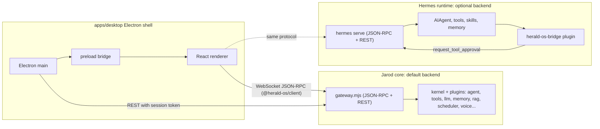

# Jarod-OS Architecture

Jarod-OS is an agent-native operating system: it makes an AI agent the primary interface between
the user and the computer. Jarod-OS Linux is the whole system (Fedora underneath, the Jarod shell
as the session); on macOS the same shell runs fullscreen over the macOS desktop, and on Windows it
runs as an application. The agent is the **Jarod core** shipped inside Jarod-OS (`jarod-core/`, a
TypeScript kernel); a Hermes Agent install can stand in for it, because both answer the same wire
protocol. Jarod-OS is a separate product from Hermes Desktop: it reuses Hermes' wire contract and
grows its own shell on top.

## Three authorities

The same seam rules upstream Hermes Desktop uses apply here:

| Party | Owns | Lives in |
| --- | --- | --- |
| Electron main | The machine: window/fullscreen lifecycle, backend process, PTYs, filesystem, app discovery, system stats, notifications, typed IPC | `apps/desktop/electron` |
| Renderer (React) | The experience: surfaces, navigation, presentation, ephemeral interaction state | `apps/desktop/src` |
| Agent backend | The work: sessions, model calls, tools, skills, memory, schedules, approvals | the Jarod core shipped in Jarod-OS (`jarod-core/`, default), or the user's Hermes install (`$HERMES_HOME/hermes-agent`) |

The renderer never touches Node or Electron directly; native power arrives through a narrow,
typed preload bridge (`window.heraldOS`). Agent behaviour is never re-implemented in React.

## Host platforms

Both seams (`HostPlatform` in Electron main, `HostAdapter` in the bridge plugin) are implemented per
host. The renderer and the agent see identical tool names and return shapes on every platform.

| | macOS | Linux (Jarod-OS Linux) | Windows |
| --- | --- | --- | --- |
| Shell runs as | fullscreen over the macOS desktop | the whole session: `greetd` -> `niri` -> shell (`cage` as a fallback) | an application: the same window as on macOS (F11 toggles fullscreen); not a session |
| `HostPlatform` | `platform/darwin.ts` (`plutil`, `sips`, `qlmanage`, `mdfind`, EventKit JXA) | `platform/linux.ts` (`/proc`, `.desktop` entries, icon themes, `nmcli`, `recently-used.xbel`, GNOME thumbnail cache) | `platform/windows.ts` (`Win32_Process`, `Get-StartApps` + `shell:AppsFolder`, the Recent folder, ripgrep, shell thumbnails) |
| `HostAdapter` | `host/darwin.py` (`osascript`, `lsof`, `mdfind`, `system_profiler`, `pmset`) | `host/linux.py` (`ps`, `ss`, `plocate`/`fd`, `gio`, `xdg-open`, `nmcli`, `bluetoothctl`, `wpctl`, `gsettings`, `journalctl`, `loginctl`) | `host/windows.py` (Windows PowerShell, `os.startfile`, `explorer.exe`, ripgrep) |
| App launch / reveal | `shell.openPath` / `showItemInFolder` | `gio launch <.desktop>` / `org.freedesktop.FileManager1` | |
| Calendar | EventKit with permission state | unavailable (EDS later) | |

Setup, session model and dev loop for Linux: `docs/LINUX.md`.

## Backend lifecycle

`apps/desktop/electron/backend/manager.ts` owns the backend process; `jarod-core.ts` decides which one.

1. **Choose.** `HERALD_OS_BACKEND=jarod|hermes` decides when set. Otherwise the Jarod core runs when
   the build has one (`<resources>/jarod-core` installed, `jarod-core/dist/gateway` in a checkout,
   or `HERALD_OS_JAROD_CORE=<folder>`), and Hermes when it does not. `HERALD_OS_BACKEND_URL` and
   `HERALD_OS_BACKEND_TOKEN` attach the shell to a backend someone else runs (`coexist.ts`).
2. **Start the Jarod core.** `node gateway.mjs --init --exit-on-stdin-close --workspace <folder>`,
   run by Jarod-OS's own executable in Node mode (`ELECTRON_RUN_AS_NODE=1`; installed), by a `node`
   shipped beside it when the build had to include one (`bundle-core.mjs` checks that the core's native
   module loads in Electron's Node), or by `node` from `PATH` (checkout). It gets its own profile
   (`JAROD_HOME=<data>/profile`, data under `%LOCALAPPDATA%\Jarod-OS`, `~/Library/Application
   Support/Jarod-OS/core` or `$XDG_DATA_HOME/jarod-os`; `JAROD_OS_DATA` moves it), the working
   folder conversations stay in (`Documents/Jarod-OS`, or `JAROD_WORKSPACE`) and the per-launch
   token (`JAROD_GATEWAY_TOKEN`). Its standard input stays open: closing it is how the shell stops
   it, the one clean stop on Windows, and the core closes its database first.
3. **Or start Hermes.** Resolve a runtime through an ordered ladder (`resolve.ts`):
   `HERALD_OS_HERMES_ROOT` -> `$HERMES_HOME/hermes-agent` managed install -> `hermes` on `PATH`,
   each probed before use; then `hermes serve --host 127.0.0.1 --port 0` with
   `HERMES_DASHBOARD_SESSION_TOKEN`, `HERALD_OS=1` and `HERMES_HOME`.
4. **Wait for it.** Read `HERMES_BACKEND_READY port=N` from stdout (both backends print it), then
   poll `GET /api/status` with `X-Hermes-Session-Token` until it answers. The gateway listens on
   `127.0.0.1` only and compares the token in constant time.
5. **Connect.** Hand `{ wsUrl, baseUrl }` to the renderer, which dials
   `ws://127.0.0.1:N/api/ws?token=...` with the upstream `JsonRpcGatewayClient`; REST calls go
   through main so the renderer only ever sees a capability, not a credential.
6. **Recover.** On exit the child is restarted with bounded backoff; after the budget is exhausted
   the shell shows a recoverable failure screen instead of spinning.

## Shell resilience

- **One instance.** The single-instance lock is claimed before anything else runs; a second launch
  exits at once (`single-instance.ts`) and the first comes to the front.
- **A crashed window.** If the shell's page dies, it is reloaded once; a second crash within a
  minute shows a recovery page (Reload, Restart in safe mode, Quit) (`recovery.ts`).
- **Safe mode.** `--safe-mode` (or `HERALD_OS_SAFE_MODE=1`) starts without widget plugins, hook
  scripts and event automations; a badge under the menu bar leads back. Settings > About > Health
  shows it, the last crash and the settings folder.
- **Settings files** are written atomically (`atomic-write.ts`), and the main window's place is
  saved on close and restored when a screen still holds it (`window-state.ts`).

## Pinokio engine

Jarod-OS ships Pinokio's engine (`pinokiod`, MIT) to install and run AI apps (ADR-022):

- `pinokio-runtime/` pins it; `apps/desktop/scripts/bundle-pinokio.mjs` prepares it for Electron and
  compiles `electron/pinokio/host.ts` beside it; installed, it is `resources/pinokiod`.
- `electron/pinokio/service.ts` starts it on demand (Jarod-OS in Node mode), uses the Pinokio app's
  engine instead when one answers on port 42000, and stops its own on quit.
- `host.ts` binds it to loopback and puts `guard.ts` (Host and Origin must be this machine) in
  front of every request and WebSocket.
- The `pinokio` window (`src/features/pinokio`) shows its UI in a web view (`openPinokio` in
  `ipc/web.ts`); `pinokio.*` OS commands and the core's `pinokio_*` tools drive it.
- `HERALD_OS_PINOKIO_PROFILE` gives the engine another `~` (its settings and home), for checks that
  must not touch the real ones; `HERALD_OS_PINOKIO_RUNTIME` points at another build.

## Wire contract

The wire is declared in Python (`tui_gateway/contracts`) and generated into
`apps/shared/src/gateway-contract.generated.ts` upstream. Jarod-OS re-exports that file through
`packages/hermes-client`, so a field the backend stops sending fails `tsc` here instead of drifting.

Sessions are created with `source: "herald_os"`. Upstream only folds Desktop-only GUI tools into
sessions whose source is `desktop`, so a Jarod-OS session never receives tools whose client half
lives in Hermes Desktop.

Server-to-client requests the shell answers: `approval`, `clarify`, `sudo`, `secret`. Anything else
is declined with `-32601` so the backend treats it as unanswered rather than hanging.

## Renderer

Paths in this section and the next are relative to `apps/desktop`.

The renderer draws a whole desktop: wallpaper, menu bar, dock, command bar (`Cmd+K`), notifications
and a small window manager. Its apps are registered in `src/shell/apps.ts`:

- **Pages** of the main Hermes window, picked from its sidebar: Overview, Hermes (chat), Missions,
  Memory, Files, Automations, Connections, Settings.
- **Floating apps** with their own window: Terminal, System, Web, Studio, and a chat pop-out.

It runs in one of two modes, chosen by Electron main (`electron/shell/mode.ts`):

| Mode | Used by | Windows |
| --- | --- | --- |
| `desktop` | macOS, Windows, Linux under `cage` | One fullscreen Electron window; the renderer's own window manager (`src/store/windows.ts`, `src/shell/wm/`) lays out every app inside it. |
| `panels` | Linux under `niri` (`HERALD_OS_SHELL_MODE=panels`) | One Electron window per surface (menu bar, dock, main window, command bar, wallpaper, each floating app), tiled by the compositor. `src/shell/ShellRoot.tsx` picks what each window shows. |

Code layout (details in [`apps/desktop/README.md`](../apps/desktop/README.md), conventions in
[`apps/desktop/DESIGN.md`](../apps/desktop/DESIGN.md)): `src/shell` is the desktop chrome,
`src/features/<app>` holds one folder per app, `src/store` the nanostores state and actions,
`src/lib` pure helpers with their tests, `src/commands` the OS command catalogue.

## OS control

Everything a user can do in the shell is also a registered command (`src/store/os-commands.ts`,
catalogue in `src/commands/`), so three callers drive the UI the same way:

1. The command bar.
2. The voice fast path (`src/lib/voice/intents.ts`), which runs simple requests such as "open
   missions" or "hide the sidebar" locally, without a model round-trip.
3. Hermes itself, through the bridge's `os_ui` tool. Electron main serves a JSON-lines Unix socket
   (`~/.hermes/herald-os/control.sock` in desktop mode, `$XDG_RUNTIME_DIR/herald-os/control.sock`
   in panels mode) and hands the backend its path and a per-launch token
   (`HERALD_OS_CONTROL_SOCKET`, `HERALD_OS_CONTROL_TOKEN`). The socket is readable only by the
   user (mode 0600) and refuses requests without the token. In panels mode it also serves the
   `herald-os` CLI that the compositor's hotkeys call; those commands need no token.

Voice (engines, wake word, barge-in) is described in [`VOICE.md`](VOICE.md).

## Pick up where you left off

The Overview leads with up to three threads of work the user may want to resume.

- **Electron main** (`electron/context/snapshot.ts`, `electron/ipc/context.ts`) takes a context
  snapshot on request: documents opened or changed in the last three days (the platform's recents
  plus new files on the Desktop and in Downloads), folders under the usual project roots with
  activity this week (branch, uncommitted changes and last commit for git repositories, read with
  `--no-optional-locks` so looking never rewrites the index), and the GUI apps running. Folders and
  words the user excluded are dropped before anything leaves main. `powerMonitor` turns a wake, an
  unlock or the end of a 15-minute idle stretch into a `context:returned` event when the user was
  away for at least ten minutes.
- **The renderer** (`src/store/continuity.ts`) adds recent Hermes conversations and today's
  calendar, numbers every entry (`f1`, `p1`, `c1`) and sends it with fixed instructions through the
  gateway's `llm.oneshot`: one stateless model call with no session, no tools and no transcript.
  `src/lib/continuity.ts` parses the JSON answer and keeps only items whose ids were in the
  evidence, so a card cannot point at a file the model made up. Threads are stored in prefs and
  refreshed on boot (when older than ten minutes), when the user returns, and on demand.
- **Acting stays with the user.** Continue reopens a thread's conversation (in Studio when it built
  the thread's project), its folder and its documents. The suggested next step is a button that
  sends the prompt Hermes proposed. A return only updates the cards, or posts a notification when
  another page is showing. `continuity.catchUp`, `continuity.continue` and `continuity.nextStep`
  expose the same actions to voice, the command bar and Hermes.

The feature stays off until the user turns it on, because the names of files, projects,
conversations and events go to the model provider.

## System bridge

With the Jarod core, system access is the core's own tools (`jarod-core/packages/plugins/tools/src/system`,
behind its approval gate and shell guard); this section is about the Hermes backend.

`plugins/herald-os-bridge` is a regular out-of-tree Hermes plugin. It registers a narrow toolset
(`herald_os`) that exposes the host machine through explicit, permission-tiered tools. Execution
happens on the backend host behind a `HostAdapter` abstraction (`darwin`, `linux` and `windows`
implemented). Sensitive operations route through upstream's own approval gate
(`tools.approval.request_tool_approval`) so the shell renders one approval card for everything.
See [`SYSTEM-BRIDGE.md`](SYSTEM-BRIDGE.md).

## Upstream compatibility

These hold for the Hermes backend and the wire contract the Jarod core implements.

- The Python runtime is never forked: it is whatever `hermes update` installs.
- Only `apps/shared/src` is compiled into Jarod-OS, from a pinned snapshot
  (`upstream/UPSTREAM.lock`, fetched by `scripts/sync-upstream.sh`).
- The plugin uses only public plugin APIs (`register`, `ctx.register_tool`, `ctx.register_skill`,
  `tools.approval.request_tool_approval`).
- Anything Jarod-OS needs from core that does not exist yet (for example a generic plugin
  server-request hook for client-side execution) is proposed upstream rather than patched locally.
